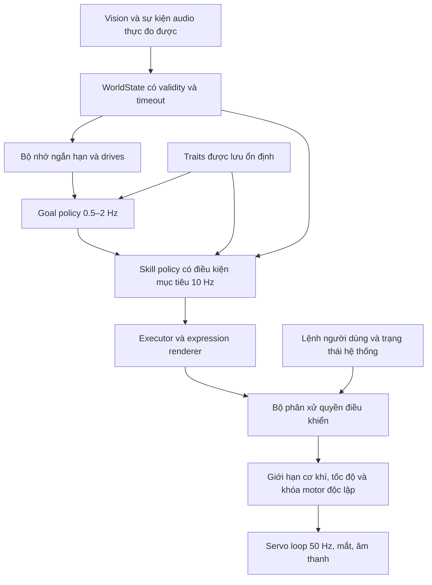

**T-Rax: từ IDLE ngẫu nhiên sang hành vi tự chủ có tính cách — đề xuất ngày 27/10/2026**

Phạm vi: phân tích mã firmware hiện tại, mã/báo cáo huấn luyện trong `t-rax-multi-policy` và nghiên cứu gốc bên ngoài. Các thông số kiến trúc, ngân sách dữ liệu và tiêu chí nghiệm thu dưới đây là đề xuất thử nghiệm, chưa phải kết quả huấn luyện mới. Lần nghiên cứu này không thay đổi firmware, không chạy training và không điều khiển robot. Những kết quả mô phỏng cũ được trình bày theo báo cáo đã lưu, không phải đánh giá chạy lại.

Khuyến nghị chính: giữ bộ điều khiển chuyển động và lớp bảo vệ xác định; thay dần bộ chọn hành vi và các quỹ đạo biểu đạt bằng policy học từ dữ liệu mẫu, có mục tiêu, bộ nhớ và tham số tính cách. Bắt đầu với thân cố định, chỉ điều khiển đầu/mắt/âm thanh. Chưa mở điều khiển bánh xích tự chủ trên bàn.

**1. IDLE hiện hoạt động như thế nào**

Nguồn chính: [idle_behavior.cc](/Volumes/BOX_120GB/project/T-Rax/t-rax-main/main/boards/t-rax/idle_behavior.cc:26), [choreography.cc](/Volumes/BOX_120GB/project/T-Rax/t-rax-main/main/boards/t-rax/choreography.cc:14).

| Lớp | Cách thực thi thực tế | Tác động đến cảm giác nhân vật |
|---|---|---|
| Chuyển động nền | Vòng lặp danh nghĩa 50 Hz; đổi hướng nhìn bình thường mỗi khoảng 4–7 giây; khi nghe khoảng 3–5,5 giây | Tạo sự sống động nhưng chủ yếu phụ thuộc thời gian và số ngẫu nhiên |
| Nhịp thở | Tổng hai sóng sin mỗi trục; biên độ thành phần Pan 7° + 2,5°, Tilt 8,5° + 3,5° | Đây là chuyển động tương đối rõ, không phải micro-motion dưới 1° như mô tả README cũ; tổng biên độ là cận trên toán học, không phải đo thực tế |
| Kịch bản | Lần đầu sau 18–28 giây; chọn `esp_random() % 28`; khi hoàn tất chờ thêm 30–35 giây nếu không bị hoạt động khác đổi lịch | Có tiết tấu câu chuyện nhưng không chọn theo vật thể, trạng thái cảm xúc, lịch sử hay phản ứng người |
| Ngủ gật | Ngưỡng thực thi `900000 ms`, tức 15 phút, dù comment/log ghi 5 phút; có ba phản xạ ngủ gật ngẫu nhiên | Ý tưởng phù hợp nhân vật; thời điểm chuyển trạng thái chưa phản ánh mệt mỏi hay bối cảnh thực |
| Nhường quyền | Khi thấy choreography bận thì bỏ qua idle; khi tracking thì dùng target Pan/Tilt của VisionReceiver | Là một số cơ chế nhường quyền riêng lẻ, chưa phải một bộ phân xử thống nhất |

`PerformScenario()` chạy đồng bộ trên task gọi nó: có nhiều lệnh chuyển động và `vTaskDelay`. Khi IDLE tự gọi hàm này, chính vòng IDLE không quay lại nhánh tracking cho tới khi chuỗi kết thúc. Đây không phải chặn toàn bộ firmware hay task audio, nhưng phản ứng của đường IDLE/servo với thay đổi bối cảnh bị trì hoãn. Cờ `is_performing_action_` cũng không thay thế cơ chế sở hữu actuator và hủy hành vi.

Sau mỗi scenario luôn có động tác trở về đầu 90°/90°, mắt cyan và chờ thêm. Cách này nối được một show diễn nhưng dễ làm đứt một hướng nhìn đang có ý nghĩa. Không thấy kiểm tra điều kiện hoàn tất theo mục tiêu, theo dõi phản hồi hoặc bộ nhớ chống chọn lặp trong bộ chọn 28 scenario.

Hai bộ số độc lập: `PerformScenario(0..27)` là 28 kịch bản, còn `TRaxState(1..28)` là trạng thái/biểu cảm, trong đó các ID cuối là kiểu chào. Không dùng hai bộ ID này làm một nhãn huấn luyện chung.

**2. Kiểm kê đủ 28 kịch bản và cách tận dụng**

Tên bên dưới là nhãn của tác giả trong code. Chúng không chứng minh robot thực sự phát hiện mùi, bọ, bão, sao, khe hẹp hoặc trạng thái pin. Các góc quay “360°/720°” là ý đồ biểu diễn; driver dùng thời gian/PWM, không có đo góc thân để xác nhận.

| ID | Kịch bản | Thành phần nên giữ làm mẫu | Hướng thay thế bằng hành vi có điều kiện |
|---|---|---|---|
| 0 | Sniff & Explore | Cúi nhìn, đổi góc quan sát, ngập ngừng rồi xác nhận | Inspect vật/góc nhìn mới; kết thúc khi đã quan sát đủ |
| 1 | Playful Wiggle Dance | Nhịp vui và phối hợp mắt/âm thanh | Ăn mừng ngắn sau tương tác thành công; bản dài theo yêu cầu |
| 2 | Stealth Dino Stalk & Pounce | Anticipation và nhịp “rình” | Giữ cử chỉ nhìn; việc tiếp cận/vồ chỉ xem xét ở giai đoạn có bảo vệ thân |
| 3 | Multi-Angle Bird Tilt | Nghiêng hướng nhìn, tạm dừng, gật xác nhận | Thay đổi góc quan sát một mục tiêu chưa rõ; phần cứng hiện có Pan/Tilt, không có trục roll độc lập |
| 4 | Surprise Look Behind | Orient nhanh rồi kiểm tra chậm | Quét vùng bị bỏ quên hoặc sự kiện có bằng chứng; không giả định biết hướng âm thanh |
| 5 | Lazy Stretch & Yawn | Ngáp, vươn cổ, trở lại tỉnh táo | Chuyển mức readiness; bỏ các lệnh xích trong bản thân cố định |
| 6 | MJ Billie Jean & Moonwalk | Tiết tấu biểu diễn | Giữ như tiết mục được yêu cầu, không là idle mặc định |
| 7 | Affectionate Nudge & Purr | Tư thế thân thiện, ngước nhìn, purr | Đáp lại người đang tương tác; chưa suy ra được chạm/xoa nếu không có cảm biến |
| 8 | Startled Reflex & Defensive Guard | Giật mình → quan sát → bình tĩnh | Chỉ kích hoạt khi có sự kiện tin cậy; thao tác bảo vệ thực nằm ngoài policy biểu cảm |
| 9 | Sleepy Low Battery | Đầu rũ và nhịp chậm | Dùng cho readiness thấp; chỉ báo pin yếu nếu có dữ liệu pin thật |
| 10 | Bug Investigation | Nhìn đa góc → chăm chú → xác nhận | Kiểm tra vật mới; không cần giả định phát hiện được bọ |
| 11 | 720° Whirl & Drunken Wobble | Nhịp mất thăng bằng giả lập | Giữ dưới dạng show được yêu cầu; không đưa xoay/lùi dài vào idle tự chủ đầu tiên |
| 12 | Proud Superhero | Nâng đầu tự tin | Phản ứng thành công ngắn, có cooldown |
| 13 | Long-Range Scan | Quét và dừng quan sát | Mẫu phù hợp cho learned gaze exploration |
| 14 | Narrow Gap Probe | Cử chỉ thăm dò | Chỉ có nghĩa điều hướng khi perception thực sự xác nhận được khe và khoảng hở |
| 15 | Wall Tracker | Tập trung sang một phía | Có thể học nhìn vật thể; chưa gọi là bám tường khi thiếu dữ liệu khoảng hở tương ứng |
| 16 | Ceiling Recon | Quan sát phía cao | Kiểm tra vùng trên theo bản đồ vùng nhìn, giữ thân cố định |
| 17 | Trail Hunter | Quan sát sát mặt đất | Inspect vùng thấp; không suy ra có khứu giác hoặc vết dấu |
| 18 | Peek-a-Boo Peek | Hé nhìn, chờ, trở lại | Trò chơi xã hội khi có người và lượt tương tác rõ ràng |
| 19 | Fake Meltdown Prank | Nhịp tăng căng thẳng rồi giải tỏa | Tách khỏi trạng thái lỗi thật; không đưa giả báo lỗi thành phản xạ idle ngẫu nhiên |
| 20 | Charge to Panic Retreat | Tương phản gan dạ/rụt rè | Giữ biểu cảm nhẹ; chưa đưa lao/lùi vào bản thân cố định |
| 21 | Stubborn Tantrum & Pouting Sulk | Pout và nhịp hờn nhẹ | Cử chỉ chơi có ngữ cảnh; không được ảnh hưởng lệnh dừng/quyền điều khiển của người |
| 22 | Smooth Moonwalker | Nhịp lùi biểu diễn | Giữ thành tiết mục được yêu cầu |
| 23 | Alien Contact Ritual | Tiếp cận biểu cảm → dò xét → chào | Tách thành greet/inspect/acknowledge ngắn, được chọn theo bối cảnh |
| 24 | Great Mosquito Battle | Tìm kiếm → hụt → thử lại → kết thúc | Học tính kiên trì và biết bỏ cuộc; không hard-code một “con muỗi” vô hình |
| 25 | Fossil Dig | Quan sát → kiểm tra → phát hiện → chia sẻ | Inspect vật/vùng thấp; đây là mẫu tính cách tò mò rất phù hợp |
| 26 | Thunderstorm to Heroic Courage | Giật mình → hồi phục → tự tin | Mô hình arousal tăng rồi giảm sau sự kiện; không suy ra robot phân loại được thời tiết |
| 27 | Stargazer | Nhìn cao → dừng → phản ứng nhẹ | Quiet curiosity, có thể là mẫu idle hiếm thay vì lúc nào cũng kết thúc bằng ăn mừng |

Kiểm kê tĩnh: **26/28 scenario có lệnh motor**; chỉ #9 và #13 không có lệnh này. Tham số motor trong script có thể tới 0,65, nhưng `SmoothDriveMotors()` chặn ở ±0,45 và tăng thời lượng danh nghĩa 1,25 lần. Không được dùng tham số script làm vận tốc thực hoặc quãng đường. Nhánh motor trực tiếp lại có giới hạn khác; mô phỏng cần phản ánh đúng đường thực thi được chọn.

Nguồn: [choreography.cc](/Volumes/BOX_120GB/project/T-Rax/t-rax-main/main/boards/t-rax/choreography.cc:19), [motion_controller.cc](/Volumes/BOX_120GB/project/T-Rax/t-rax-main/main/boards/t-rax/motion_controller.cc:187).

Giá trị lớn nhất của thư viện là ngôn ngữ biểu đạt: anticipation, dừng quan sát, tương phản nhanh/chậm, phối hợp đầu–mắt–âm thanh, và đoạn kết. Điểm yếu là thời điểm chọn, việc theo đuổi mục tiêu và khả năng thay đổi trước thông tin mới. Huấn luyện nguyên chuỗi 28 bài thành 28 action chỉ học một bộ chọn show tốt hơn; chưa thay được phần tạo chuyển động hay phát triển hành vi mới.

**3. RL hiện có: có thể kế thừa gì, còn thiếu gì**

| Nhánh | Bằng chứng trong repo | Cách dùng trong kế hoạch mới |
|---|---|---|
| Behavioral v1 | Actor 39→128→128→5, ReLU; header firmware trùng SHA-256 với artifact `autonomous_behavioral_dynamics/1.0.0` | Đối chứng và tham chiếu runtime; không mặc định đây là nền tảng đã học được tính cách |
| Purposeful v2 | 54D; goal có phase, bộ nhớ, điều kiện kết thúc; nominal skills + learned residual | Kế thừa lifecycle, telemetry và bài test; phải tách hiệu quả của luật khỏi hiệu quả policy |
| Desk social v1 | Actor 71D, hai hidden Tanh, 5 action; observation Dict; báo cáo 524.288 transitions | Kế thừa thiết kế tình huống xã hội và hạ tầng train/eval; cần contract thực tế và export mới trước deploy |

Báo cáo `legacy_behavioral/evaluation.json` ghi pass rate khoảng 29,2% trong bài đánh giá được lưu; nhiều hành vi không hoàn tất mục tiêu. Đây là kết quả theo điều kiện của báo cáo đó, không phải đo tỷ lệ thành công trên robot đang chạy.

Báo cáo purposeful v2 ghi cả nominal controller và bản residual vượt các gate. Chính báo cáo nêu chưa có bằng chứng residual sau 4.096 bước tốt hơn nominal. Vì vậy “80/80 episode đạt” không đủ để kết luận RL đã tạo ra sự tự chủ.

Báo cáo desk social ghi tỷ lệ đáp nhìn vẫy tay 50% trên bộ test và 65% trên audit; lịch/bố trí còn có cấu trúc cố định. Đáp nhìn được đo bằng hướng nhìn và dwell, chưa phải hiểu ý định hoặc tương tác hai chiều. Mốc này hữu ích làm prototype mô phỏng, chưa phải mức sẵn sàng triển khai.

Tham chiếu: [purposeful v2](/Volumes/BOX_120GB/project/T-Rax/t-rax-multi-policy/reports/purposeful_v2/implementation.md), [desk social](/Volumes/BOX_120GB/project/T-Rax/t-rax-multi-policy/reports/desk_social_rl/training_report.md), [deployment readiness](/Volumes/BOX_120GB/project/T-Rax/t-rax-multi-policy/reports/deployment_readiness_2026-10-15/assessment.md).

Các điểm phải giải quyết trước khi train tiếp cho robot:

1. **Quyền điều khiển IDLE:** RL task ghi target vào VisionReceiver, trong khi IdleBehavior chỉ dùng target đó khi đang tracking. Khi không có mục tiêu, quỹ đạo idle cũ vẫn điều khiển đầu. Đầu ra bánh xích và attention của actor chưa được nối thành đầy đủ hành vi vật lý/mắt/âm thanh. Cần một executor dùng chung và một chủ sở hữu actuator tại mỗi thời điểm.
2. **Runtime dài hạn:** `BehaviorManager::Update()` giữ mutex rồi gọi `SaveToNvs()` lấy lại cùng mutex; log lần flash trước ngừng RL gần 60 giây, phù hợp lỗi này. `uint32_t(dt_sec)` còn làm uptime không tăng ở bước 0,1 giây; `interaction_count++` mỗi tick có target cũng không phải số lượt tương tác. Các lỗi này làm sai cả hành vi lẫn dữ liệu đánh giá.
3. **Sai semantics observation:** temporal train v1 chia 10 giây, adapter firmware chia 30; novelty/embedding/motion có nhiều hằng số; trạng thái một target được dùng thay cho các kênh face/object riêng. Ngay cả 39 số đúng kích thước vẫn chưa cùng một observation contract.
4. **Class và độ mới dữ liệu:** protocol quy định face=1, ball=2, nhưng BehaviorManager coi class 1 là BALL. WorldState có thể giữ `target_visible=true` khi mất stream, vì không tự chuyển hết hạn trong GetSnapshot; trong khi đường tracking có timeout riêng. Cần tuổi dữ liệu, validity và timeout thống nhất.
5. **Số đo và ước lượng:** Pan/Tilt trong WorldState là setpoint gửi xuống servo, PWM là lệnh/giá trị phần mềm, không phải encoder đo chuyển động. Không coi chúng là vận tốc/pose thật. `energy_budget` là biến nội tại mô phỏng, không phải điện lượng pin được đo. Tài liệu ngày 15/10 ghi thiếu encoder, IMU và cliff sensors; chưa có bằng chứng trong lần nghiên cứu này rằng phần cứng đã được bổ sung.
6. **Safety nhất quán:** ToF đang tắt; `ENABLE_CHASSIS_BALL_CHASE=0` không khóa toàn bộ motor của choreography/MCP. Clamp PWM/góc không tạo thành bảo vệ va chạm hay mép bàn. Bản head-only cần khóa motor tại lớp thực thi cho mọi nguồn lệnh trong chế độ thử đó.
7. **Contract model mới:** runtime hiện giới hạn input 48, hidden 128, output 8; exporter chưa xử lý observation Dict của nhánh desk, quantizer hiện chặn ngoài 6/39 và chưa giữ đúng Tanh. Không thay trực tiếp header 54D/71D vào firmware hiện tại.

Nguồn: [RL task](/Volumes/BOX_120GB/project/T-Rax/t-rax-main/main/boards/t-rax/t_rax_board.cc:37), [adapter 39D](/Volumes/BOX_120GB/project/T-Rax/t-rax-main/main/boards/t-rax/autonomous_idle_policy.cc:43), [drives/NVS](/Volumes/BOX_120GB/project/T-Rax/t-rax-main/main/boards/t-rax/behavior_manager.cc:122), [WorldState](/Volumes/BOX_120GB/project/T-Rax/t-rax-main/main/boards/t-rax/world_state.cc:34).

**4. Mục tiêu hành vi và tính cách có thể đo được**

Đề xuất nhân vật khởi điểm: “khủng long nhỏ tò mò, thân thiện, hơi rụt rè, nghịch vừa phải và biết lúc nào nên yên”. Đây là lựa chọn thiết kế để bắt đầu, có thể đổi theo sở thích của chủ robot.

| Thành phần | Tốc độ thay đổi | Ví dụ thể hiện ra ngoài |
|---|---|---|
| Traits `p` | Giữ ổn định qua phiên và khởi động | Tò mò, mức hướng tới người, tinh nghịch, mức dè dặt |
| Mood/drives `d(t)` | Thay đổi theo sự kiện, thường chậm hơn chuyển động | Arousal, nhu cầu tương tác, readiness, quen kích thích |
| Memory `m(t)` | Cập nhật theo quan sát và kết quả hành vi | Đã nhìn vùng nào, vừa xin tương tác chưa, mục tiêu cũ còn tin cậy không |
| Goal `g(t)` | Giữ đủ lâu để hoàn thành/timeout | Nghỉ, quét, inspect, acknowledge, chờ phản hồi, tìm lại mục tiêu |
| Style | Điều chế cử chỉ trong giới hạn | Biên độ gật, tốc độ quay, thời gian ngập ngừng, độ mạnh chirp |

Tính cách ổn định không đồng nghĩa lặp đúng cùng một động tác. Cùng trait có thể chọn cách biểu đạt khác tùy bối cảnh, nhưng giữ xu hướng nhất quán. Ngược lại, tăng entropy/randomness chỉ tạo biến thiên; chưa tạo được nhân vật.

Không gán một trait cố định duy nhất cho cả training rồi kỳ vọng mạng hiểu biến trait. Phải thay `p` giữa các episode và có mục tiêu/style supervision tương ứng; giữ `p` ổn định trong từng episode dài. Kiểm tra mạng có thật sự dùng `p` bằng thử cùng cảnh với các trait khác, và cùng trait ở nhiều cảnh mới. Các thay đổi do mood không được tùy tiện ghi đè trait lâu dài.

**5. Kiến trúc khuyến nghị**

Tầng goal quyết định điều nên làm tiếp theo; mỗi goal có tiến độ, timeout, hủy và kết quả. Một lần nhìn thấy người không bắt buộc phải chào. Có thể nhìn nhận ngắn, đợi một lượt, rồi yên nếu không được đáp. Tầng skill quyết định cách di chuyển và biểu đạt trong goal đó; executor nội suy và giới hạn lệnh. Safety/hủy theo lệnh người không được chờ policy quyết định.

Giai đoạn chuyển tiếp có thể giữ goal manager bằng luật và chỉ học style/residual, nhưng phải gọi đúng là giai đoạn chuyển tiếp. Đích thay thế bộ chọn kịch bản cần policy học cả chọn goal/thời điểm, không chỉ sửa chút biên độ quanh một lịch viết sẵn.

Khởi đầu dùng bộ nhớ explicit và MLP nhỏ vì runtime hiện có Dense/ReLU int8. Chỉ dùng GRU/LSTM khi đã có bằng chứng bộ nhớ explicit không đủ và có đường export/runtime hỗ trợ; không đưa RNN vào training rồi bỏ hidden state khi deploy. LLM có thể diễn giải lệnh hoặc đặt ý định hiếm, không nằm trong vòng servo thời gian thực.

**6. Observation/action đầu tiên nên bám phần cứng**

Đề xuất `idle_personality_head_v1`: chỉ dùng dữ liệu có thể tạo lại trên S3 từ vision packet, trạng thái ứng dụng, lệnh actuator và bộ nhớ hữu hạn. Không dùng vị trí thật MuJoCo, tên người biết sẵn, hướng nguồn âm thanh hoặc góc thân thật khi robot không có nguồn đo tương ứng.

Một phân bổ minh họa để giữ input ở mức **48 scalar** hiện runtime có thể chứa:

| Nhóm | Số chiều dự kiến | Nội dung |
|---|---:|---|
| Kinematics của lệnh | 6 | Pan/Tilt setpoint, vận tốc và gia tốc lệnh trước; tên trường ghi rõ là commanded/estimated |
| Perception một target | 12 | Visible, 4 one-hot face/ball/cup/hand, x/y, w/h, confidence, tuổi target, chuyển động ảnh ước lượng |
| Bối cảnh tương tác | 6 | Listening, speaking, yêu cầu đang chờ, thời gian từ lần thấy người/chirp/đổi goal |
| Drives | 5 | Curiosity, social need, arousal, readiness, habituation |
| Goal và memory | 11 | 6 goal one-hot; thời gian phase, tiến độ dwell, vị trí X nhớ gần nhất, novelty vùng nhìn, số lần lặp goal |
| Traits | 4 | Bốn trục tính cách ổn định |
| Validity | 4 | Stream vision, ước lượng motion, memory target và readiness estimate có hợp lệ không |

Đây là đề xuất contract, không phải khẳng định firmware hiện đã xuất đủ 48 trường. Cần quy định UNKNOWN/mask cho class ngoài tập, xử lý dữ liệu mất, chuẩn hóa, đơn vị, saturation và schema hash. Goal selector không dùng goal one-hot hiện tại để học theo một nhãn “đáp án” viết sẵn; đó chỉ là trạng thái goal trước đó. Nếu feature không mang thông tin hoặc không đo được, bỏ nó và train lại thay vì điền hằng số giả.

Đầu tiên: policy goal nhỏ với 6 logits ở nhịp chậm; actor skill có điều kiện goal ở 10 Hz xuất tốc độ Pan/Tilt và một ít tham số style. Cho mắt/âm thanh đi qua renderer theo phase và cooldown. Sau khi chứng minh mô hình này hữu ích, mới học thêm đầu ra expressive rời rạc. Không coi một scalar attention là đủ để thay mọi âm thanh/màu mắt trong 28 kịch bản.

Tách yêu cầu và thực thi chirp: policy có thể đề nghị, còn executor kiểm tra cooldown, trạng thái listening/speaking và ngân sách âm thanh. Không cho điểm social chỉ vì robot tự phát ra chirp.

**7. Hướng train: demonstration → PPO theo mục tiêu → cá nhân hóa**

**Bước A — làm baseline và đo hệ thống.** Sửa các điểm contract/runtime/quyền actuator ở mục 3; ghi log đồng bộ observation, goal, action yêu cầu/thực thi, override, reward components, latency và lifecycle. Đo servo trễ, giới hạn, deadband; dùng chúng trong plant mô phỏng. Chọn cùng control rate cho train/deploy. Chu kỳ inference 10 Hz và nội suy 50 Hz là cấu hình khởi điểm, chưa phải kết quả tối ưu hóa.

**Bước B — lấy cử chỉ ngắn làm dữ liệu.** Tách các motif khoảng 0,5–3 giây từ #0, #3, #5, #7, #10, #12, #13, #18, #25, #27; rút gọn số chirp và bỏ motor trong bản thân cố định. Bổ sung mẫu nghỉ thật sự, nhìn nhận ngắn, ngừng xin chú ý, chuyển hướng giữa chừng. Nhãn gồm goal, phase, style, target-relative gaze và kết quả; không chỉ `scenario_id`. Chuyển quỹ đạo tuyệt đối thành hướng nhìn tương đối mục tiêu khi phù hợp. Tạo biến thể thời gian/biên độ có giới hạn và replay qua plant có trễ, không đồng nhất setpoint với góc đo.

Mốc dữ liệu thử nghiệm có thể là 8–12 motif, mỗi motif 10–20 biến thể, rồi pilot với dữ liệu điều khiển tay thực. Đây là ngân sách khởi động để đánh giá, không có bằng chứng số mẫu đó bảo đảm chất lượng.

**Bước C — behavior cloning rồi PPO.** Pretrain actor skill để giữ nhịp biểu đạt; sau đó fine-tune PPO trong MuJoCo với mục tiêu phải hoàn thành trước nhiễu, thay đổi mục tiêu và mất dữ liệu. Giữ imitation/style regularizer đủ để không mất ngôn ngữ nhân vật; giảm mức buộc theo đúng clip khi cần phản ứng mới. Tận dụng PPO và hạ tầng train/eval hiện có. Exporter hiện chưa hỗ trợ SAC đầy đủ, nên đổi thuật toán ngay chưa giải quyết nút thắt hiện tại.

**Bước D — học lựa chọn có bộ nhớ.** Thay bộ chọn `%28` bằng goal policy dùng bối cảnh và lịch sử. Huấn luyện vòng: nhận thấy → quan sát/xác nhận → đợi → kết thúc hoặc tìm lại. Giữ termination do safety/người dùng ở ngoài policy. Đổi cảnh không được bắt robot tiếp tục diễn một đoạn “chiến thắng” không còn phù hợp.

**Bước E — train family tính cách có điều kiện.** Lấy mẫu trait giữa các episode; reward/style tag phải thay đổi có chủ đích theo trait. Ví dụ cùng nhìn thấy vật mới: bản dè dặt quan sát lâu hơn và tiếp cận bằng đầu; bản tinh nghịch có một cử chỉ ngắn hơn rồi chờ. Bài test phải kiểm tra profile chưa thấy trong training và bối cảnh mới. An toàn, quyền người dùng và độ tin cậy cảm biến không là các trọng số có thể tắt bằng trait.

**Bước F — sở thích của chủ robot.** So sánh cặp clip trong cùng bối cảnh: cách nào tự nhiên, phù hợp, dễ nhận ra tính cách và ít làm phiền hơn. Có thể dùng điểm này làm nhãn reranking hoặc train reward model rồi fine-tune có giới hạn. Bắt đầu với batch offline nhỏ và duyệt lại; chưa cho robot tự cập nhật weight ngay trên S3 khi đang tương tác.

Không cần đưa motion prior/discriminator, reward model hoặc critic lớn xuống robot. Nếu dùng teacher lớn, distill sang actor MLP ReLU nhỏ với đúng observation deploy. Không thể giữ năng lực phụ thuộc state ẩn của teacher nếu student không được cung cấp bộ nhớ/thông tin tương đương.

**8. Reward và curriculum**

Reward nên trả lời “đã làm điều có ích trong bối cảnh này chưa” và “thể hiện như T-Rax chưa”, thay vì thưởng cho độ nhiều chuyển động.

| Term | Tín hiệu có thể dùng | Hành vi sai cần chống |
|---|---|---|
| Tiến độ goal | Dwell đủ trên target có confidence, hoàn tất quan sát, dừng sau phản hồi | Nhìn thấy mục tiêu thoáng qua nhưng nhận toàn bộ điểm; goal tự reset để kiếm thưởng |
| Novelty | Vùng nhìn/thực thể mới xác nhận, lợi ích giảm khi đã quan sát | Tự quay đầu tạo optical flow, đuổi noise hoặc mất target để được “phát hiện lại” |
| Social reciprocity | Một lượt nhìn nhận/xin tương tác và phản hồi trong cửa sổ hợp lệ | Kêu liên tục; coi mọi target là người; nhận điểm vì phản ứng người không liên quan |
| Quiet readiness | Nghỉ ít chuyển động nhưng vẫn phản ứng khi có sự kiện | Đứng im suốt episode để tối đa reward quiet |
| Style | Sai khác trajectory/velocity/phase với motif phù hợp ngữ cảnh | Cố replay clip dù người vừa ra lệnh dừng |
| Smoothness | Vận tốc/gia tốc/slew, bám limit lâu, thay goal quá dày | Chỉ phạt chuyển động rồi khiến policy bất động |
| Intrusiveness | Số chirp, thời gian kêu, thời gian nhìn liên tục, lặp yêu cầu | Tránh mọi tương tác vì penalty quá mạnh |

Các chi phí theo thời gian nhân `dt`; thưởng sự kiện chỉ nhận một lần khi có completion/response hợp lệ. Ghi riêng từng term và kiểm tra đối chứng đứng yên, nhìn cố định, spam chirp. Internal drives giảm nhờ kết quả được xác nhận, không chỉ nhờ có bbox. Không coi `energy_budget` tăng lúc nghỉ là pin thật tự sạc.

Curriculum đề xuất:

1. Phòng yên: nghỉ mà vẫn sẵn sàng; một target xuất hiện rồi biến mất.
2. Vật mới và vật quen; thay vị trí, kích thước, confidence; học kết thúc inspect.
3. Người xuất hiện, ngồi im, đi qua; một lượt xin chú ý được đáp và bị bỏ qua.
4. Ngắt giữa hành vi, lệnh người dùng, listening/speaking; mất packet và target ngoài FOV.
5. Episode dài 10–30 phút với nhiều sự kiện lẫn khoảng lặng; không cho thời điểm episode tiết lộ lịch sự kiện.
6. Sau khi bản đầu ổn định mới thêm đa target/stable IDs và trạng thái thân nếu phần cứng/perception thực đã cung cấp được.

Randomization nên gồm lịch sự kiện, cảnh/vị trí người-vật, ánh sáng/FOV, occlusion, false positive, packet delay/drop, servo lag/backlash, deadband, giới hạn góc và tư thế đầu ban đầu. Với bản thân cố định, khóa thân ngay trong môi trường train/eval; không train thân tự do rồi chỉ chặn motor lúc deploy.

Critic/reward trong simulator có thể dùng state thật để hỗ trợ huấn luyện; actor chỉ nhận observation có thể tạo trên robot. Các phản ứng người tổng hợp chỉ là proxy để tạo bài học, không phải bằng chứng robot đã hiểu ý định xã hội thật.

**9. Chuyển giao và tiêu chí thay thế script**

| Giai đoạn | Quyền của policy | Điều kiện để đi tiếp |
|---|---|---|
| Shadow | Chỉ dự đoán/ghi log, script vẫn chạy | Contract replay Python/C++ trùng; không stale target, không deadlock NVS, không chặn audio |
| Head-only nhỏ | Thay gaze/saccade; khóa mọi motor; giữ show thủ công | Phản ứng đúng bối cảnh và mượt hơn baseline, hủy/chuyển quyền đúng, không tăng can thiệp |
| Head + expressive idle | Thay dần idle motif, điều phối mắt/chirp bằng renderer | Blind A/B cho thấy phù hợp/tự nhiên hơn; mức làm phiền không tăng |
| Goal autonomy | Policy chọn mục tiêu, thời điểm, kết thúc | Thắng baseline goal bằng luật và policy không có memory/traits trên test độc lập |
| Mobile personality | Mở các hành vi thân đã chọn | Đã có số đo/bảo vệ vật cản và mép phù hợp, contract tốc độ/PWM được kiểm chứng trên robot |

Mỗi bước cần công tắc fallback; safety hoặc dữ liệu quá hạn phải thu hồi quyền ngay. Tắt kịch bản idle tương ứng khi policy sở hữu actuator; không trộn hai lệnh servo không có quy tắc arbitration. Boot, lỗi thật, pin thật và dừng khẩn vẫn thuộc logic hệ thống.

Export phải giữ thứ tự features extractor, chuẩn hóa, activation, action scaling, timestep và memory reset. Dùng calibration từ rollout thực tế nhiều bối cảnh và trạng thái hiếm; không chỉ vector random. So FP32→ONNX→int8→C++ trên bộ observation cố định, sau đó so hành vi closed-loop. Action ở gần ranh giới quyết định cần kiểm tra riêng; sai số số học nhỏ không tự bảo đảm cùng hành vi.

Model đầu có thể thử hidden 64 hoặc 128, ReLU để thuận runtime. Với schema 48D mới vẫn phải cập nhật manifest/quantizer/adapter và kiểm chứng; không chỉ tăng `MAX_INPUT_DIM`. Đo p50/p95/p99 inference đồng thời với Wi-Fi, WakeNet và playback. Log firmware trước cho thấy actor 39D chạy được, nhưng chưa phải benchmark model mới hoặc cam kết latency.

Các đối chứng tối thiểu: idle hiện tại; đứng yên; goal controller bằng luật; behavior cloning; BC+PPO không trait; BC+PPO có trait; nominal với residual bật/tắt. Báo rõ contribution của phần học được và phần bằng luật.

Đo ba nhóm riêng: năng lực (hoàn tất inspect, response latency, reacquisition, hủy đúng); biểu đạt (jerk, stare, lặp, chirp/phút, yên thực sự ở cả đầu lẫn thân); tính cách (người quan sát nhận ra profile qua cảnh mới, tính nhất quán và mức làm phiền). Không dùng tổng reward, action entropy hoặc idle_fraction của thân thay cho cả ba nhóm.

Đề xuất bắt đầu test nhiều seed/bố trí/lịch sự kiện tách hẳn train/validation; seed chỉ đổi trễ toàn lịch chưa đủ. Báo mẫu số, số episode, khoảng tin cậy và lỗi theo tình huống. Pilot A/B dùng cùng bối cảnh, video ẩn tên controller và thứ tự ngẫu nhiên; chọn ngưỡng nghiệm thu sau khi có baseline, không chọn ngưỡng chỉ vì model hiện tại vượt được. Thử endurance trên robot phải dài hơn ngưỡng 60 giây đang có vấn đề và kiểm tra cùng tải audio/mạng.

**10. Nghiên cứu gốc và mức áp dụng**

- [DeepMimic, 2018](https://arxiv.org/abs/1804.02717): kết hợp imitation từ motion mẫu với task reward để giữ chất lượng chuyển động và thích ứng mục tiêu. Áp dụng đề xuất cho T-Rax là học các motif ngắn có điều kiện, không sao chép hình thái humanoid.
- [Design and Control of a Bipedal Robotic Character, Disney/RSS 2024](https://la.disneyresearch.com/publication/design-and-control-of-a-bipedal-robotic-character/): kết hợp chuyển động do nghệ sĩ thiết kế với RL để thực thi trên robot dưới command. Có giá trị cho phong cách chuyển động; không tự chứng minh robot sẽ chọn mục tiêu xã hội tự chủ.
- [AMOR, SIGGRAPH 2025](https://la.disneyresearch.com/publication/amor-adaptive-character-control-through-multi-objective-reinforcement-learning/): train policy có điều kiện theo trade-off reward, cho phép điều chỉnh sau training và dùng trong hệ phân cấp. Đề xuất biến trade-off/style thành family tính cách của T-Rax là hướng nghiên cứu riêng cần kiểm chứng bằng người quan sát, không phải kết quả được bài báo bảo đảm.
- [AMP, 2021](https://xbpeng.github.io/projects/AMP/): học motion prior từ dữ liệu chuyển động để cung cấp style reward. Chỉ nên thử sau baseline BC+PPO, khi đã có tập motion đủ đa dạng; chưa cần mang discriminator xuống S3.
- [The Option-Critic Architecture, AAAI 2017](https://arxiv.org/abs/1609.05140): cơ sở cho học hành vi kéo dài theo thời gian và điều kiện kết thúc. Đề xuất ban đầu chỉ kế thừa cách tách goal/skill/termination; không bắt buộc triển khai nguyên thuật toán Option-Critic.
- [Deep Reinforcement Learning from Human Preferences, 2017](https://arxiv.org/abs/1706.03741): học reward từ so sánh đoạn hành vi. Hữu ích cho đánh giá “giống T-Rax” sau khi năng lực và giới hạn đã ổn định.
- [Asymmetric Actor Critic, 2017](https://arxiv.org/abs/1710.06542): hỗ trợ dùng state đầy đủ ở critic trong simulator, còn actor chỉ nhận quan sát triển khai được. Đây là phân biệt quan trọng để tránh policy phụ thuộc dữ liệu robot không có.

Ưu tiên triển khai đầu tiên: sửa runtime và hợp đồng dữ liệu; tạo baseline thân cố định với sáu goal và một thư viện motif ngắn; chứng minh BC+PPO tốt hơn nominal bằng luật trước khi mở rộng tính cách và bánh xích. Các kịch bản cũ trở thành dữ liệu phong cách, bộ đối chứng và show theo yêu cầu; policy mới chịu trách nhiệm ngày càng nhiều hơn cho thời điểm, mục tiêu và cách biểu đạt.
